# Knit Knack

*Tap, tap, tap: knit anything, one real stitch at a time.*

Every tap knits exactly one stitch. Watch a hat, a mitten, a cable cowl or a little knitted fox
grow on the needles, stitch by stitch, in the colors and yarns you pick. Hats, socks and
mittens go round and round as real tubes, the way knitters really make them. Work through a
book of 47 real patterns, hang what you make in your gallery, dress a shelf of little dolls in
it, arrange them all in a cozy room, and keep coming back to the Infinite Scarf, which never
ends.

**[▶ Play Knit Knack](https://knitknack.synapticnoise.com/)** in your browser. No install, works
on desktop and on phones.

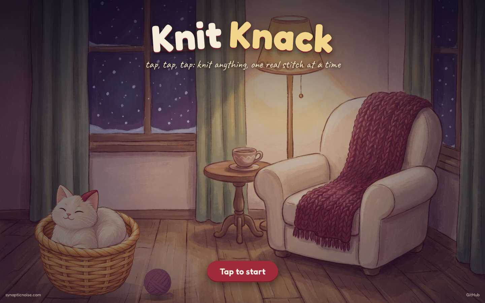

## Knitting

Each stitch is drawn the way real knitting looks: knit Vs, purl bumps, cables crossing, lace
eyelets, colorwork in your own colors. The needles really work the loops, flat work turns at
the end of every row, and the strip below shows the row in real pattern wording
(`k5 A, k3 B, k6 A`). Change yarn any time, even on a single stitch.

| | |
|---|---|
| 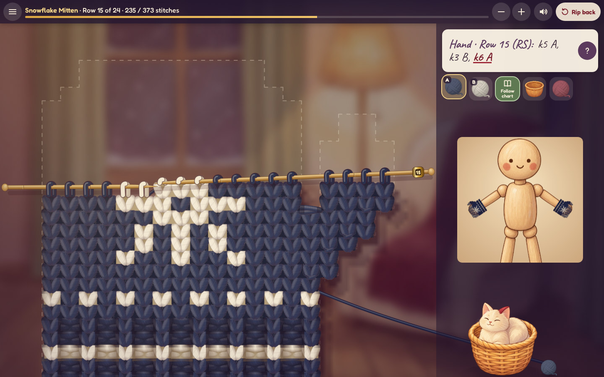 | 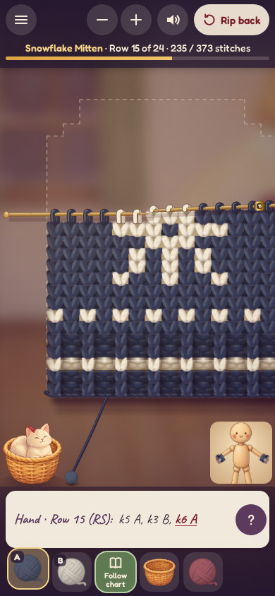 |

## Knitting in the round

Hats, headbands, cowls, socks, mittens, mitts and the sweaters' bodies are knit in the round,
as real knitters make them: the work is a tube that turns as you go, on a circular needle or a
set of double-pointed needles. The patterns read by round ("Rnd 4: *k4, k2tog; rep from *
around"), a hat's crown narrows and gathers, a sock's heel is turned and its toe grafted, and
nothing has a seam. Cables now stand out like little twisted ropes.

| | |
|---|---|
| 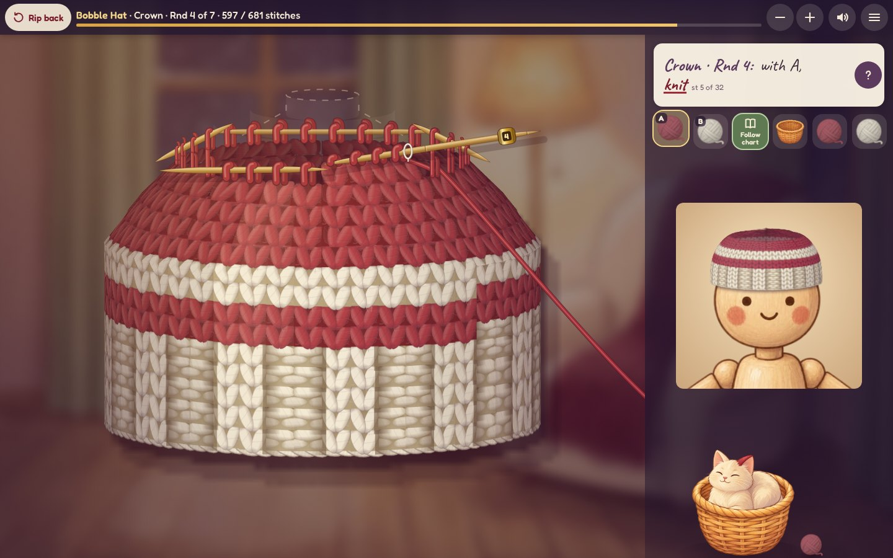 | 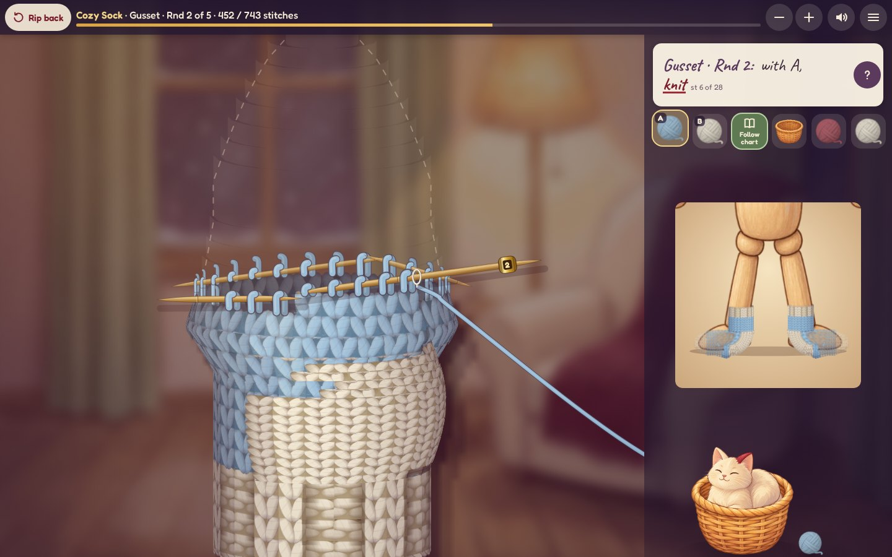 |

## The Pattern Book

47 patterns in 7 chapters: **First Stitches**, **Warm Things**, **Colorwork**, **Cables and
Texture**, **Lace**, **Knitted Friends** (a bunny, a cat, a whale, a frog, a penguin, an
octopus, a fox and a teddy bear) and **Big Projects** (a tea cosy, a stocking, a dog sweater,
blankets, a yoke sweater, a cardigan and an heirloom afghan). You start with three, and every
piece you finish unlocks the next.

Every pattern is a real one you could knit, with a full written pattern behind
**Read the pattern**.

| | |
|---|---|
| 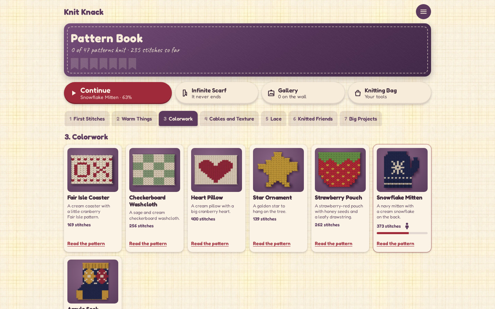 | 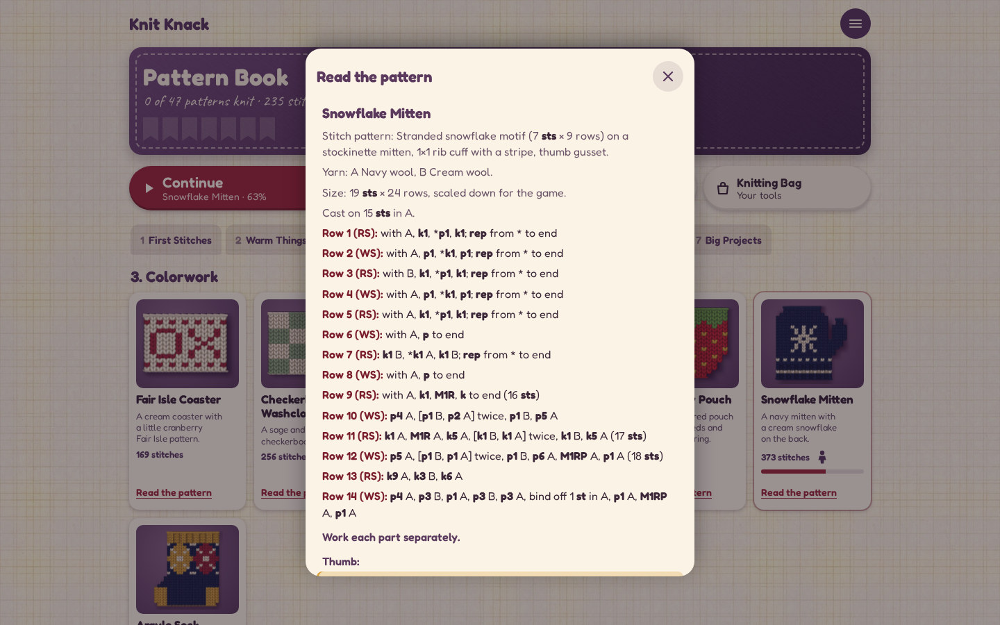 |

## Yarn

Pick from 30 colors or mix your own, in eight kinds of yarn that each knit up differently:
**wool** and **cotton** to start, then **chunky**, fuzzy **mohair**, twinkling **sparkle**,
**self-striping**, rich **velvet**, and **glow** yarn that shines when you turn the gallery
lights out. Follow the chart and colorwork appears by itself, or go freestyle and color every
stitch your own way.

## Finishing and the gallery

When the last stitch is done, the piece is bound off and blocked, Purl wakes up to cheer, and
you hang it on your gallery wall.

| | |
|---|---|
| 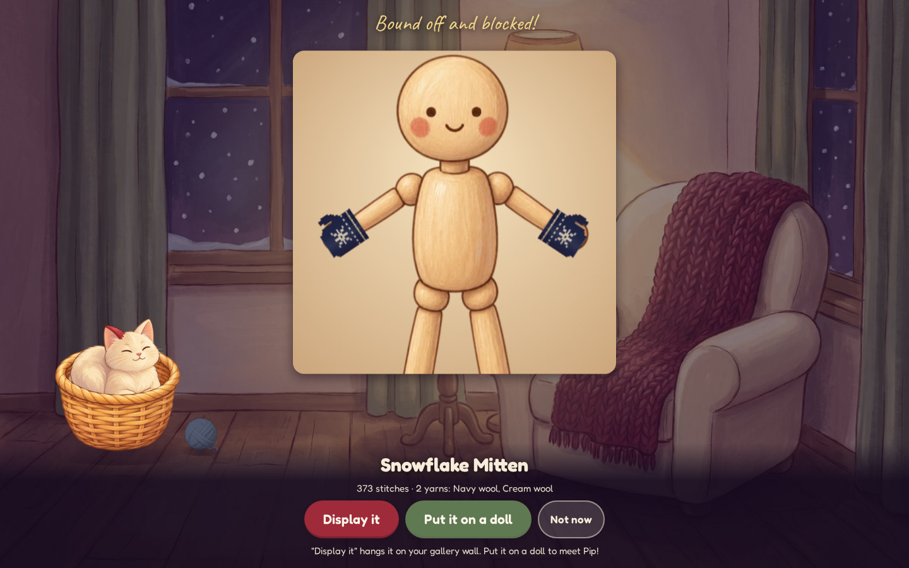 | 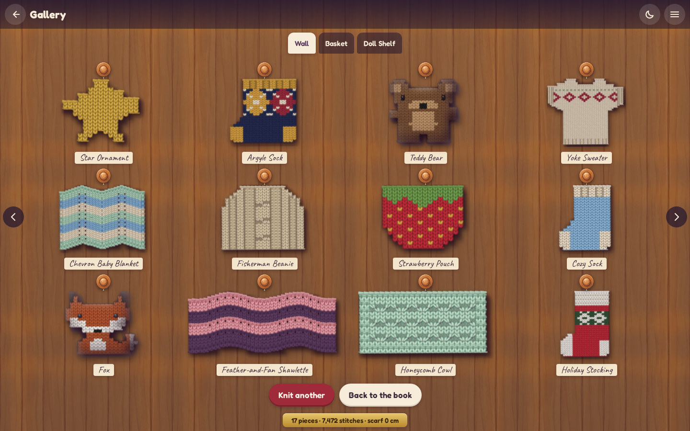 |

Pillows and toys are sewn up and stuffed, so they look soft and plump wherever they show: in
the gallery, the close-up, the finished screen, the Pattern Book and the room.

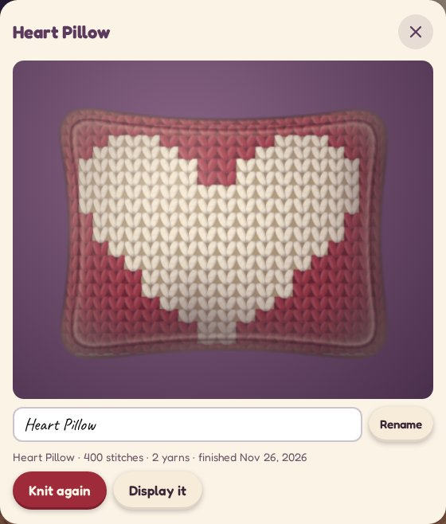

## The dolls

Meet Pip, Clementine, Bramble, Juniper, Basil, Mabel and Purl herself, and dress them in the hats,
cowls, sweaters, mittens and socks you knit, stitch for stitch as you made them. The round
pieces wear as true tubes: a hat wraps the head, a cowl circles the neck, socks hug the feet.

| | |
|---|---|
| 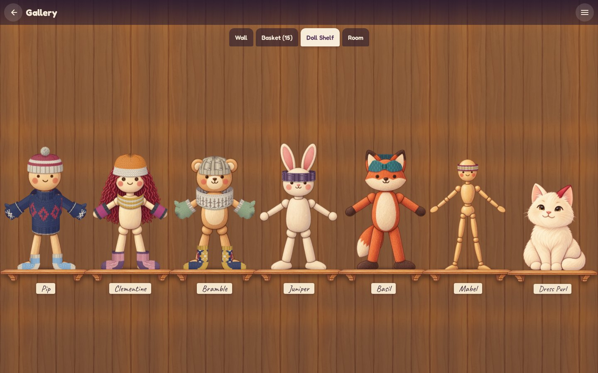 | 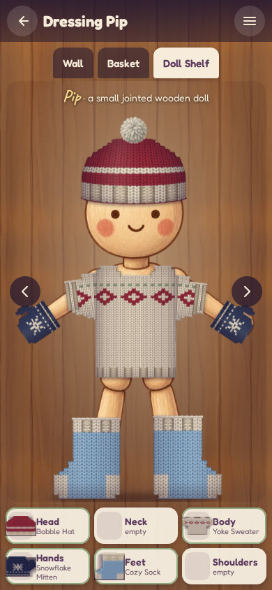 |

## The cozy room

Bring everyone together in a little painted room. Drag your dolls, Purl, the toys you knit,
your pillows and blankets onto the rug, the armchair, the shelves and the window seat, dressed
in whatever they wear. Your toys and pillows sit there plump and stuffed, and the shelves have
room enough for the dolls up top to stand tall. Unlock room pieces as you knit (a side table, a
plant, storybooks, a toy chest, a tea set, a star garland, a floor lamp and a frame that shows
your newest piece). The room stays just as you left it.

Your Infinite Scarf hangs on a peg rail above the armchair, in the colours you knit it, with its
needles still in the last row and a tag with its length. It grows as you knit: a scarf folded
over a peg, then swags from peg to peg, then rows of garlands (on a phone, loops hanging down),
and past 100 m a knitting bag on the last peg, stuffed with the rest. Tap it for **Knit more**,
and come back to see how far it has grown.

| | |
|---|---|
|  | 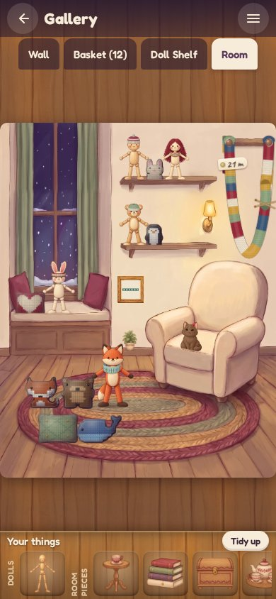 |

## The Knitting Bag

There's no shop and no money. As you knit you unlock 12 pairs of needles (bamboo to clear
glass, each with its own click), stitch markers, row counters, yarn holders, cozy things for
the nook, and a collar, bell and cushion for Purl. They change how things look and sound;
nothing ever knits for you.

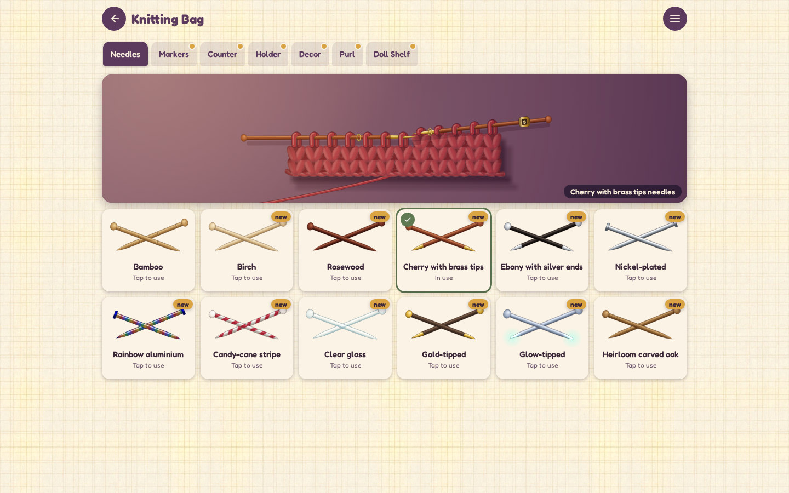

## The Infinite Scarf

A scarf that never ends. Every row adds a centimeter. **How long is it?** stands it up beside
the last thing it passed and the next one, from a mug and a guitar to a giraffe, a blue whale,
the Leaning Tower of Pisa and, someday, the Moon, with a knitting fact every so often. It also
hangs on the wall of the cozy room, growing across its pegs as you knit.

| | |
|---|---|
| 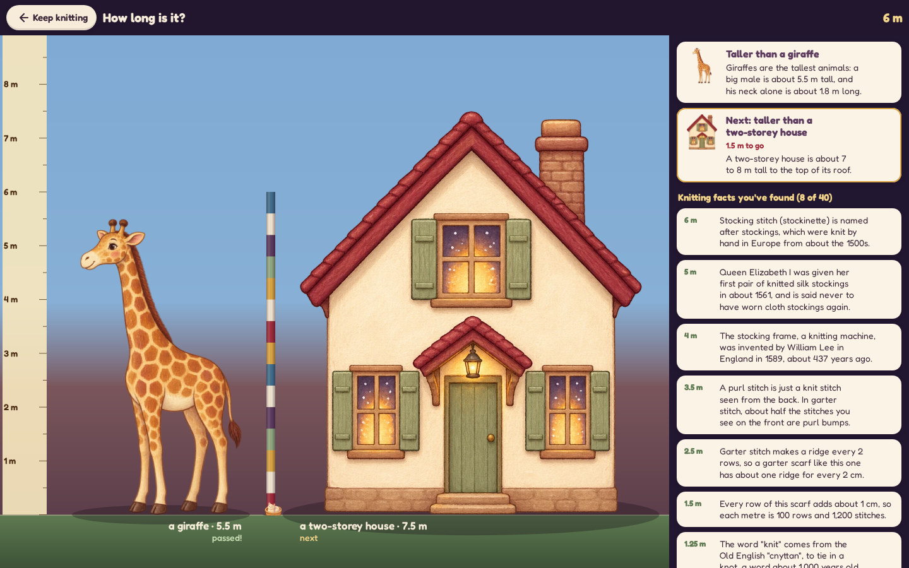 | 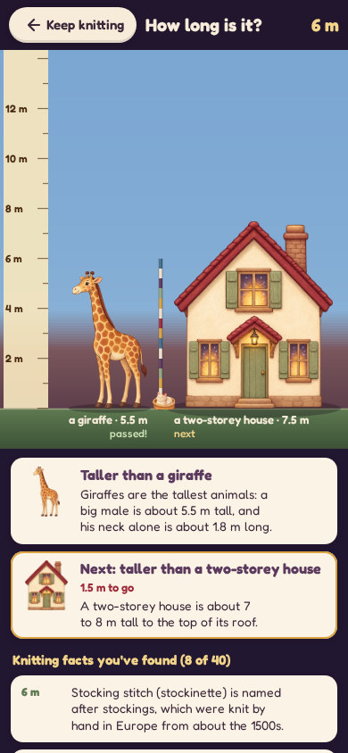 |

## How to play

- **Knit a stitch:** tap or click anywhere on the work, or press Space, Enter or K.
- **Rip back:** the Rip back button (hold to keep ripping), or Backspace or U.
- **Change yarn:** tap a skein in the yarn bar, or press 1 to 4. Press 5 to 9 for your recent
  yarns, Y for the whole basket, and C to follow the chart again.
- **Zoom:** − and + (0 fits the work), or the scroll wheel on a computer.
- **Preview card:** tap it or press V. **Pattern glossary:** the "?" button or G.
- **The cozy room:** drag a thing from Your things into the room, or tap it and then tap a
  spot. Tap something in the room for **Move**, **Turn**, **Look closer** and **Put away**, or
  drag it back to the tray. **Tidy up** puts everything away. With a keyboard: Tab to a thing,
  Enter to pick it up, the arrow keys to move it (Up and Down change places), Enter to set it
  down, Delete to put it away.
- **Menu:** the button at the top right, or Escape or P. **Mute:** M.
- **Your cat:** tap the cat in the basket to give it a pet. Each new game brings a cat with its own coat and knitting name; change both in Settings.
- **Unlock everything:** a switch in Settings opens every pattern, yarn, needle, accessory and doll, if you'd rather just knit. Your earned progress is kept.
- On a phone, just tap: every finger knits, so two-thumb drumming works. The yarn bar is along
  the bottom, and Rip back is at the top left, out of the way of your thumbs. Your phone's back gesture steps back inside the game. You can install it
  from your browser's menu to play full screen, even offline.

There's no losing and no timer. Your pieces in progress, your gallery, your dolls, your room and
your scarf are all saved in your browser.

Found a bug? Pause and pick "Report a bug", or press Ctrl+Shift+F (you'll need a GitHub account).

## How it was made

Knit Knack was made by [Claude Code](https://claude.com/claude-code) with
[gamegen](https://github.com/zeveck/gamegen), from this request:

> A game in which you tap to knit. We need a bunch of cool things to knit, with real patterns, and the idea is you have needles and yarn and can pick the color and you knit whatever. You start with a few patterns, but can unlock more. We should have like 47 maybe? But when you "play" it's just a clicker -- each tap of the screen knits one stitch of the work, and you see it form over time. When you finish, you can just "display" the item in your gallery. You can change the color and type of the yarn. They are settable at any time, including on any stitch, so you can make things colored how you want. The key is tap --> knit knit knit until done. You can also work on your "infinite scart" which is just a scarf that gets longer and longer and maybe has some fun graphics/facts to depict the length as it gets longer and longer. --plan-only --share-design --art-sheet --feedback Real patterns the knit graphics/animation should look like you're really knitting the thing you're knitting and reflect color choices.

That made a plan and a design page with a few mock pictures. After a "yes" to sharing the
plan, the game was built from this follow-up, which added unlockable needles and accessories
and the doll shelf:

> --art-sheet --budget 50 --out knit-knack --feedback it's critical they be real patterns, real knits, and tapping produces good looking knit animations that track and help you feel like you're making the thing and it looks right and reflects your colors and yarn. you should be able to unlock needles and accessories and such. maybe small dolls to put your knits on. --publish --no-confirm

Then two changes. This one put hats, socks, mittens and the rest on circular and
double-pointed needles as turning tubes, rewrote 19 patterns by round, and gave the cables
their rope-like look:

> --change knit hats, socks, mittens, mitts, cowls, headbands and the sweater's body in the round as real knitters do: show the work as a tube on circular needles (or double-pointed needles for socks and mittens), word their patterns by round ("Rnd", every round from the right side, garter as knit and purl rounds), and finish them without seams (crown gathered, heel turned, toe grafted), so they wear on the dolls as true tubes. Keep flat what's really knit flat (dishcloths, coasters, blankets, scarves, the toys' pieces). Fix anything else we knit flat that shouldn't be. Playability and a strong feel of really knitting matter more than proving every rule: loosen the pattern checks where they get in the way, but keep the written patterns honest. Also give the cables a more raised, rope-like look.

And this one added the cozy room, with its eight room pieces to unlock:

> --change let finished toys and dolls sit together in a little cozy room scene you can arrange: drag them onto a rug, an armchair, shelves and a window seat, dressed in what you knit, with the arrangement saved; unlock a few room pieces as you knit

Meanwhile, four reports filed with the game's own "Report a bug" button (going back with a swipe, the menu's place, a cat of your own, and an unlock-everything switch) were fixed with:

> --fix all --publish --no-confirm

And three more changes, all asked for at once:

> Do all three gamegen changes you suggested then publish no-confirm.

The three were:

- `--change repaint the cozy room's landscape picture with more space between the shelves so dolls up top are bigger`:
  the room's shelves were moved apart and the dolls on them drawn about a third bigger, with a
  peg rail painted in for the scarf. The pictures were recomposed in Pillow from the old ones,
  with no new generation ($0).
- `--change make pillows and toys look soft and stuffed in the gallery close-up too`: pillows and
  toys are drawn sewn up and stuffed everywhere they show, not as flat knitted pieces.
- `--change let the infinite scarf hang in the cozy room, growing across the wall as it gets longer`:
  the Infinite Scarf hangs on the room's pegs in your own colours, from a fold to swags,
  garlands or loops, and a knitting bag past 100 m, with its length tag, live needles, Knit more
  and a little moment when you come back and it has grown.

gamegen designed the game, had review agents polish the design, made the art, animation, music
and sound with these plugins, built it, and play-tested it:

| | |
|---|---|
| 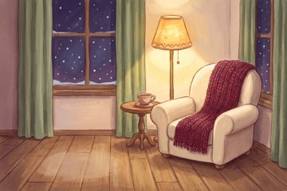 | [nanogen](https://github.com/zeveck/nanogen): the knitting nook and the cozy room (landscape and portrait, later recomposed in Pillow for roomier shelves and the scarf's pegs), the wood, paper and yarn-fibre textures, and the knitted swatches the stitch drawing was tuned against. |
| 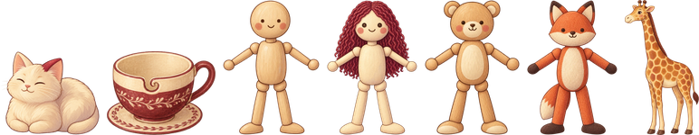 | [imagegen2](https://github.com/zeveck/imagegen2): Purl, her basket, the yarn balls, the six dolls, the 20 scarf comparisons (mug to redwood), the yarn holders, nook decor and finishing touches, the props, the room pieces (table, plant, storybooks, toy chest, tea set, garland and lamp) and the app icon. |
| 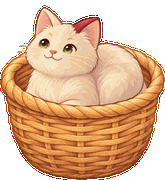 | [anim8gen](https://github.com/zeveck/anim8gen): Purl's cheer when you finish a piece. |
|  | [audiogen](https://github.com/zeveck/audiogen): 5 songs (three for the nook, one for the gallery, one for the scarf) and 23 sounds, from wooden, metal and glass needle clicks to Purl's mew and purr, and the soft click of a round being joined. |

The stitches, the turning tubes, needles, dolls' outfits, Purl's coats, scarf sky and everything else are drawn in code, so
every piece shows exactly the yarns you chose. A knitting tech editor reviewed all 47 written
patterns, and every problem it found was fixed.

## Replaying the tests

The patterns are checked by the same code the game runs:

- `node tools/check-chart.mjs` checks the chart engine on a few test charts: the row map, the
  wording and the round trip from text back to rows.
- `node tools/check-patterns.mjs` checks all 47 patterns: repeats, shaping, cables and lace
  only on right-side rows, stitch counts, and that every written pattern reads back exactly.
  Add `--solve` to run every pattern's whole stitch order, or `--text` to write all the
  written patterns to `tools/patterns.txt`.
- `node tools/solutions.mjs` plays the whole game in a browser from a fresh save: all 47
  patterns in book order, with yarn changes, rip backs and reloads along the way, then checks
  every unlock fired once. It serves the game itself and needs Playwright.

## Playing locally

Knit Knack is a plain web page with no build step. Serve the `game` folder with any static web
server, for example:

    cd game
    python3 -m http.server 8000

then open http://localhost:8000.

## Credits

The idea is Rich Conlan's. The fonts are [Fredoka](https://fonts.google.com/specimen/Fredoka)
and [Caveat](https://fonts.google.com/specimen/Caveat), both under the SIL Open Font License
(bundled in `game/fonts/`).
